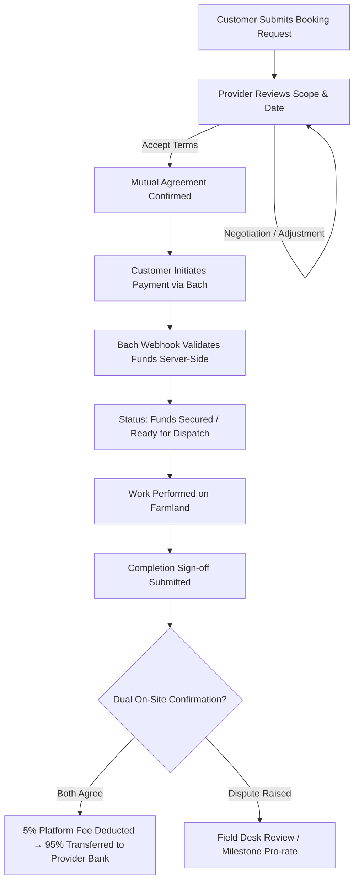

# TerraTills Platform Documentation & Architecture Guide (`update.md`)

*Version: 1.0.0 — Production Specification & Implementation Reference*  
*Target Territory: Federal Republic of Nigeria (36 States + FCT)*  
*Platform Type: Nigeria-First Agricultural Services Marketplace & Unified Participant Dashboard*  

---

## Table of Contents
1. [Executive Overview & Mission](#1-executive-overview--mission)
2. [People & Stakeholders Served](#2-people--stakeholders-served)
3. [Non-Negotiable Product & Architectural Principles](#3-non-negotiable-product--architectural-principles)
4. [Color System & Visual Design Hierarchy](#4-color-system--visual-design-hierarchy)
5. [End-to-End Workflow & Business Logic](#5-end-to-end-workflow--business-logic)
   - [5.1 The Unified Account & Dual-Participant Model](#51-the-unified-account--dual-participant-model)
   - [5.2 Service Listing Lifecycle](#52-service-listing-lifecycle)
   - [5.3 Booking & Negotiation State Machine](#53-booking--negotiation-state-machine)
   - [5.4 Payment, Settlement & Bach Rails](#54-payment-settlement--bach-rails)
   - [5.5 Dual-Confirmation Work Sign-Off](#55-dual-confirmation-work-sign-off)
   - [5.6 Verification & Trust Pipeline](#56-verification--trust-pipeline)
   - [5.7 AI Assistant Boundary Rules](#57-ai-assistant-boundary-rules)
6. [Technology Stack & System Architecture](#6-technology-stack--system-architecture)
7. [Frontend Model & Complete Page Catalog (31 Pages)](#7-frontend-model--complete-page-catalog-31-pages)
   - [7.1 Public Pages (5 Pages)](#71-public-pages-5-pages)
   - [7.2 Authentication Pages (3 Pages)](#72-authentication-pages-3-pages)
   - [7.3 Authenticated Dashboard Pages (23 Pages)](#73-authenticated-dashboard-pages-23-pages)
   - [7.4 Reusable Layout Components & Navigation](#74-reusable-layout-components--navigation)
8. [Backend API Reference & Endpoint Registry](#8-backend-api-reference--endpoint-registry)
9. [Database Schema & Data Models](#9-database-schema--data-models)
10. [Security, Authorization & Compliance](#10-security-authorization--compliance)
11. [Installation, Build & Deployment Guide](#11-installation-build--deployment-guide)

---

## 1. Executive Overview & Mission

**TerraTills** is a unified, Nigeria-first digital agricultural services marketplace designed to bridge the structural mechanization deficit, land accessibility fragmentation, and informal labour friction across Nigerian agricultural corridors.

### The Problem in Nigerian Agriculture
1. **Acute Tractor Deficit:** Nigeria has fewer than 7 tractors per 100 square kilometers of arable land (compared to a global benchmark of 200). Machinery remains idle in one state while crops rot unplanted in an adjacent state due to zero visibility and coordination.
2. **Disputed Land Tenure & Middlemen Scams:** Arable land leasing is plagued by fraudulent agents, boundary disputes, customary title conflicts, and opaque pricing.
3. **Labour Mobilization Volatility:** Planting and harvesting windows require organized, vetted crews; traditional word-of-mouth contracting leads to missed seasonal windows and unfulfilled terms.
4. **Informal Payment Defaults:** Transactions conducted via unverified bank transfers or cash advance arrangements frequently result in disputes, delayed mobilizations, and non-performance.

### The TerraTills Solution
TerraTills creates an authoritative, transparent digital operating system for Nigerian agriculture:
- **Unified Market:** One single account allows any participant to lease land, hire tractors, book labour crews, or offer their own services.
- **Server-Verified Payments:** Direct integration with **Bach payment rails** guarantees that booking funds are verified server-side via webhooks before work commences.
- **Dual Completion Sign-off:** Funds are cleared for payout only when both the service hirer and the service provider inspect and verify the physical work done on-site.
- **Rigorous Verification:** Tiered identity validation (NIN, BVN, phone), GPS polygon boundary verification for farmland, and mechanic inspection badges for heavy equipment.

---

## 2. People & Stakeholders Served

TerraTills serves six primary participant personas through a single, non-fragmented interface:

| Persona | Key Needs & Behaviors on TerraTills | Contextual Role |
| :--- | :--- | :--- |
| **Smallholder & Medium Farmers** | Needs 55HP–85HP tractors for ploughing/ridging; leases 2–10 hectares; hires seasonal weeding/harvesting squads; accesses practical agronomy guides. | Customer (hirer) |
| **Farmland Owners & Communities** | Possesses registered or customary arable hectares; seeks vetted commercial tenants; requires binding seasonal/annual lease contracts with clear boundaries. | Provider (lessor) |
| **Machinery Owners & Fleet Operators** | Owns tractors, combine harvesters, boom sprayers, or de-stoners; requires guaranteed booking schedules, certified operators, and secure fuel/maintenance terms. | Provider (operator) |
| **Labour Gang Foremen & Work Crews** | Organizes 5 to 25 experienced farm labourers; seeks structured milestone agreements for planting, spraying, and bagging with guaranteed payment on inspection. | Provider (labour) |
| **Agronomists & Agro-Trainers** | Delivers practical field masterclasses (soil amendment, greenhouse horticulture, drip irrigation, export crop curing); issues verified attendance certifications. | Provider (trainer) |
| **Agribusinesses & Institutional Cooperatives** | Manages contract farming across hundreds of hectares; requires multi-service bundles (land + machinery + certified labour) with transparent audit logs. | Hybrid (Hirer & Provider) |

---

## 3. Non-Negotiable Product & Architectural Principles

The architecture strictly enforces 12 immutable product rules:

1. **One Account, One Unified Dashboard:** No mutually exclusive account types (no separate "Farmer Portal", "Landowner App", or "Labour Dashboard"). Any user can hire and provide simultaneously.
2. **Multiple Simultaneous Services:** A single user can list farmland, rent out a tractor, and offer labour crews from one profile.
3. **Contextual Participant Roles:** `customer` and `provider` are transactional roles tied to an individual booking record, not permanent identity labels.
4. **Categorized Listings:** Listings are strictly classified under:
   - `farmland` (Farmland Leasing)
   - `machinery` (Machinery & Tractor Rental)
   - `labour` (Farm Labour Crews)
   - `training` (Agricultural Training & Tutorials)
   *(Architecture extensible to future agro categories).*
5. **Staff Administration Separation:** Administrative and regulatory approval consoles are completely decoupled from this user dashboard.
6. **Server-Side Authorization:** Access controls and record permissions are validated on the backend API (`x-user-id` session check), not simply obscured in the UI.
7. **Independent Booking, Payment & Settlement States:** A booking request is not paid; an agreement must precede payment; payment does not equal instant payout.
8. **Mutual Agreement Precedes Payment:** Both parties must agree on scope, dates, hectares, price, and logistics before any payment checkout is unlocked.
9. **Server-Side Payment Proof via Bach:** Browser redirects are never accepted as proof of settlement. All transactions require webhook or direct server API verification with Bach.
10. **Non-Escrow Compliance:** The platform avoids unauthorized legal terms like "escrow" unless licensed; arrangements are legally documented as milestone-cleared payment settlements under Bach terms.
11. **Strictly Advisory AI:** AI assistants may parse queries, recommend equipment sizes, and guide agronomy practices, but are **strictly barred** from approving KYC, certifying equipment, confirming work, or releasing money.
12. **Bach as Authoritative Payment Rail:** Bach APIs and webhooks are strictly integrated behind provider adapters; successful financial operations are never simulated.

---

## 4. Color System & Visual Design Hierarchy

The visual identity follows an explicit mathematical color distribution to convey authority, sustainability, and high legibility across diverse devices and lighting conditions:

```
┌────────────────────────────────────────────────────────┐
│  COLOR PALETTE HIERARCHY                              │
│                                                        │
│  █████████████████████████ 50% Deep Teal    (#003D37) │
│  ██████████                20% Harvest Gold (#FFC900) │
│  ███████                   15% White        (#FFFFFF) │
│  ████                       8% Soft Sage    (#E4EFDF) │
│  ██                         5% Green        (#559B45) │
│  █                          2% Charcoal     (#10271B) │
└────────────────────────────────────────────────────────┘
```

| Token Name | Hex Code | Visual Proportion | Core Usage |
| :--- | :--- | :--- | :--- |
| **Deep Teal** | `#003D37` | **50% (Dominant)** | Desktop TopHeader, Mobile sticky headers, Sidebar navigation, major section titles, dark CTA banners, public footer, card accent lines. |
| **Harvest Gold** | `#FFC900` | **20% (Action)** | Signature call-to-action buttons ("Let's Create Initiative", "Book Now", "Sign Up"), square category icons, unread notification badges, price highlights. |
| **White** | `#FFFFFF` | **15% (Surface)** | Card surfaces, clean modal dialogues, form input containers, high-contrast readable content zones. |
| **Soft Sage** | `#E4EFDF` | **8% (Atmosphere)** | Hero background wash, secondary card fills, floating live badge containers, table header fills, subtle borders. |
| **Green** | `#559B45` | **5% (Life/Accent)** | Floating botanical hero illustrations, verified checkmarks, status tags ("Active", "Verified"), leaf flourishes, growth indicators. |
| **Charcoal** | `#10271B` | **2% (Contrast)** | Deep body typography, high-contrast labels, button text over harvest gold, crisp icon outlines. |

---

## 5. End-to-End Workflow & Business Logic



### 5.1 The Unified Account & Dual-Participant Model
Every registered user record contains both **Hirer** activities and **Provider** activities:
- `user.bookings`: Inquiries where the user is hiring equipment or land.
- `user.services`: Listings created by the user to offer services.
- `user.serviceRequests`: Inbound inquiries sent by other users requesting the user's services.
Switching between hiring and providing happens contextually with zero re-login or profile switching.

### 5.2 Service Listing Lifecycle
Listings progress through structured states:
1. `draft`: Incomplete form saved locally or in draft cache.
2. `active`: Visible in explore directory, searchable by category, state, and rate.
3. `paused`: Temporarily unavailable (e.g. tractor undergoing scheduled maintenance).
4. `suspended`: Flagged by trust & safety for title conflict or safety audit.

### 5.3 Booking & Negotiation State Machine
1. **Inquiry Submitted (`inquiry_submitted`):** Customer specifies hectares/days, desired dates, and farm coordinates.
2. **Mutual Agreement (`terms_agreed`):** Provider accepts or negotiates scope, fuel provision, accommodation, or travel surcharges.
3. **Payment Unlocked (`payment_pending`):** Only when both sides accept terms does the "Pay via Bach" action become active.
4. **Funds Secured (`paid_confirmed`):** Bach server webhook verifies payment.
5. **Execution (`in_progress`):** Equipment or labour crew arrives on-site.
6. **Completion Sign-off (`completion_pending`):** One party marks job complete.
7. **Settled (`completed`):** Dual confirmation unlocks bank payout.

### 5.4 Payment, Settlement & Bach Rails
- **Customer Price:** 0% markup. Customers pay the exact base fee agreed with the provider.
- **Provider Fee:** 5% standard marketplace platform commission deducted automatically upon settlement.
- **Settlement Timing:** Instant disbursement to verified Nigerian commercial bank accounts via NIP/Bach rails upon dual confirmation.
- **Webhook Resilience:** All payments are verified using HMAC signatures and server-to-server transaction queries.

### 5.5 Dual-Confirmation Work Sign-Off
Work clearance requires affirmative sign-off from both:
1. **The Hirer (Customer):** Confirms that ploughing depth, acreage, or labour outputs match contractual milestones.
2. **The Provider:** Confirms hours worked, fuel balance, and equipment release.

### 5.6 Verification & Trust Pipeline
- **Tier 1 (Instant):** Phone number SMS OTP validation + Email verification.
- **Tier 2 (Identity):** NIN (National Identification Number) or BVN name matching.
- **Tier 3 (Arable Land Authority):** Customary Chief consent document, Certificate of Occupancy (C of O), or Surveyor GIS boundary validation.
- **Tier 4 (Machinery Certification):** Engine chassis number, proof of purchase/lease, and certified operator license.

### 5.7 AI Assistant Boundary Rules
The embedded **Agro AI** is governed by strict system guardrails:
- **Allowed:** Calculating seed density per hectare, advising on tractor horsepower needed for heavy clay soil, explaining Bach settlement steps, suggesting fair benchmark rates per state.
- **Prohibited:** Approving verification submissions, certifying land ownership, triggering payments, resolving contract disputes, or releasing settlement funds.

---

## 6. Technology Stack & System Architecture

```
┌────────────────────────────────────────────────────────┐
│  FRONTEND CLIENT (Vite 8 + React 19 + Tailwind v4)    │
│  - Single-Page App Router (Dynamic Route Context)      │
│  - Mobile-First App Shell (Flush 0-margin headers)     │
│  - Botanical Floating Animation Keyframe Engine       │
│  - Responsive Desktop Sidebar + Mobile Bottom Nav Bar  │
└──────────────────────────┬─────────────────────────────┘
                           │ JSON REST APIs (HTTP / Webhooks)
┌──────────────────────────▼─────────────────────────────┐
│  BACKEND SERVER (Node.js + Express 5)                  │
│  - Session & Record-Level Auth Middleware              │
│  - Reactive In-Memory Database Engine (db.js)          │
│  - Public Auth Gateway (Register / Login / Reset)      │
│  - Agro AI Assistant Query Processor                   │
│  - Bach Payment Adapter & Webhook Event Dispatcher     │
└────────────────────────────────────────────────────────┘
```

| Layer | Technology | Version | Purpose |
| :--- | :--- | :--- | :--- |
| **Runtime Environment** | Node.js | v20+ / ES Modules | Modern async runtime for server and tooling. |
| **Client Framework** | React | `^19.3.1` | Concurrent rendering, stateful hooks, modular UI. |
| **Bundler & Dev Server** | Vite | `^8.3.6` | Ultra-fast HMR and minified production asset bundling. |
| **CSS Utility Framework**| Tailwind CSS | `^4.3.5` | Modern CSS `@theme` variables, zero-runtime overhead. |
| **Icons & Micro-Visuals**| Lucide React & Custom SVG | `^1.70.0` | Accessible, crisp agricultural vector iconography. |
| **Server Framework** | Express | `^5.3.0` | High-throughput HTTP API router and middleware stack. |
| **Concurrency Runner** | Concurrently | `^10.0.7` | Unified development command for server and client. |
| **Typography** | Plus Jakarta Sans | Google Fonts | Modern geometric display and legible small-screen UI. |

---

## 7. Frontend Model & Complete Page Catalog (31 Pages)

The platform provides **31 fully implemented functional pages**, divided into Public, Authentication, and Authenticated Dashboard views:

```
Platform Pages (31 Total)
├── Public Showcase (5 Pages)
│   ├── /                 LandingPage.jsx
│   ├── /about            AboutPage.jsx
│   ├── /services         ServicesPage.jsx
│   ├── /pricing          PricingPage.jsx
│   └── /contact          ContactPage.jsx
├── Authentication (3 Pages)
│   ├── /login            LoginPage.jsx
│   ├── /signup           RegisterPage.jsx
│   └── /forgot-password  ForgotPasswordPage.jsx
└── Authenticated Dashboard (23 Pages)
    ├── /dashboard                     DashboardOverview.jsx
    ├── /dashboard/explore             ExploreServices.jsx
    ├── /dashboard/explore/category/:s ServiceCategory.jsx
    ├── /dashboard/explore/search      SearchResults.jsx
    ├── /dashboard/listing/:id         ListingDetails.jsx
    ├── /dashboard/listing/:id/book    BookingRequest.jsx
    ├── /dashboard/bookings            MyBookings.jsx
    ├── /dashboard/bookings/:id        BookingDetails.jsx
    ├── /dashboard/bookings/:id/conf   BookingConfirmation.jsx
    ├── /dashboard/services            MyServices.jsx
    ├── /dashboard/services/new        AddService.jsx
    ├── /dashboard/services/:id        ServiceDetailsManagement.jsx
    ├── /dashboard/services/:id/edit   EditService.jsx
    ├── /dashboard/service-requests    ServiceRequests.jsx
    ├── /dashboard/messages            MessagesView.jsx
    ├── /dashboard/notifications       NotificationsView.jsx
    ├── /dashboard/verification        VerificationView.jsx
    ├── /dashboard/assistant           AIAssistantView.jsx
    ├── /dashboard/profile             ProfileView.jsx
    ├── /dashboard/settings            SettingsView.jsx
    ├── /dashboard/reviews             ReviewsView.jsx
    ├── /dashboard/saved               SavedItems.jsx
    └── /dashboard/support             SupportView.jsx
```

### 7.1 Public Pages (5 Pages)
1. **`LandingPage.jsx` (`/`):**
   - **Hero Section:** Ambient botanical green wash (`#E4EFDF` + `#559B45`), multi-axis floating leaf SVGs (`animate-float-slow`, `animate-float-reverse`, `animate-float-sway`), floating live agricultural status badges (`🌱 100% Soil Profile Verified`, `🚜 4,800+ Tractors Active`), large display typography in Deep Teal `#003D37`, Harvest Gold `#FFC900` CTA pill, and sweeping undulating green farmland panoramic banner with green halo shadow.
   - **About Section:** Quantitative impact metrics (90% delay reduction, 75K contracts), mechanization thumbnail, and bulleted features.
   - **Service Quadrants:** Interactive 4-card slider with sketch render, active card reveal, and gold icon badges.
   - **Scale Statistics:** Massive `₦210B+` investment milestone display with project counters.
   - **Transparency Framework:** 3-step operational clarity breakdown.
   - **Final Banner & Footer:** High-contrast Deep Teal CTA banner and comprehensive institutional footer.
2. **`AboutPage.jsx` (`/about`):** Platform mission, problem breakdown in Nigerian agriculture, and the 4 architecture integrity pillars.
3. **`ServicesPage.jsx` (`/services`):** Complete catalog breakdown across Farmland, Machinery, Labour, and Tutorials with benchmark rates and verification rules.
4. **`PricingPage.jsx` (`/pricing`):** Detailed breakdown of 0% customer fee, 5% provider commission, Bach settlement rails, and financial FAQs.
5. **`ContactPage.jsx` (`/contact`):** Interactive operational inquiry form with regional field desk routing (Kaduna, Ibadan) and 2-hour SLA response tracker.

### 7.2 Authentication Pages (3 Pages)
6. **`LoginPage.jsx` (`/login`):** Email/phone sign-in, password visibility toggle, error notifications, and one-click quick demo login buttons for instant test evaluation.
7. **`RegisterPage.jsx` (`/signup`):** Unified account registration form collecting full legal name, email, Nigerian phone, primary agricultural state, town, and password with terms agreement.
8. **`ForgotPasswordPage.jsx` (`/forgot-password`):** 3-stage password recovery state machine (Code Request → 6-Digit Code Verification → New Password Creation).

### 7.3 Authenticated Dashboard Pages (23 Pages)
9. **`DashboardOverview.jsx` (`/dashboard`):** Unified executive cockpit showing greeting with user's first name, live weather widget for agricultural planning, horizontal sliding services carousel (5 items + "See All"), active bookings overview, pending inquiries, and floating action button (FAB) to chat with Agro AI.
10. **`ExploreServices.jsx` (`/dashboard/explore`):** Browse all listings with multi-filter bar (category, Nigerian state, price range, verification badge) and sorting.
11. **`ServiceCategory.jsx` (`/dashboard/explore/category/:slug`):** Vertical-specific category listing page (e.g. all available tractors or farmlands).
12. **`SearchResults.jsx` (`/dashboard/explore/search`):** Search result view with query highlighting and filter preservation.
13. **`ListingDetails.jsx` (`/dashboard/listing/:id`):** Deep listing inspection: photos, provider verification card, GPS soil specs, equipment horsepower, benchmark pricing, availability calendar, and direct booking trigger.
14. **`BookingRequest.jsx` (`/dashboard/listing/:id/book`):** Scope negotiation form: input dates, hectares, equipment specs, custom notes, and automatic price estimation.
15. **`MyBookings.jsx` (`/dashboard/bookings`):** Hirer's booking management portal with status tabs (Active, Pending Terms, Completed, Cancelled).
16. **`BookingDetails.jsx` (`/dashboard/bookings/:id`):** Authoritative booking hub showing live lifecycle tracker, scope summary, payment trigger (via Bach), dual completion sign-off, and dispute escalation.
17. **`BookingConfirmation.jsx` (`/dashboard/bookings/:id/confirmation`):** Success confirmation screen showing transaction reference, provider contact details, and next operational steps.
18. **`MyServices.jsx` (`/dashboard/services`):** Provider's listings management console: view performance metrics, edit availability, toggle active/paused states.
19. **`AddService.jsx` (`/dashboard/services/new`):** Multi-step listing creation wizard collecting title, category, location, pricing model, specifications, and photo uploads.
20. **`EditService.jsx` (`/dashboard/services/:id/edit`):** Edit existing service parameters, rates, and operational descriptions.
21. **`ServiceDetailsManagement.jsx` (`/dashboard/services/:id`):** Performance analytics per listing: total booking inquiries, conversion rate, earnings, and customer reviews.
22. **`ServiceRequests.jsx` (`/dashboard/service-requests`):** Inbound inquiries queue for providers: accept terms, negotiate dates/rates, or reject with clear reasons.
23. **`MessagesView.jsx` (`/dashboard/messages`):** Real-time conversational messaging between hirers and providers with contextual booking chips.
24. **`NotificationsView.jsx` (`/dashboard/notifications`):** Activity notification feed: booking updates, verification approvals, payment clearing, and mark-as-read actions.
25. **`VerificationView.jsx` (`/dashboard/verification`):** Trust center: submit NIN/BVN, upload farmland boundary deeds, register tractor serials, and track review status.
26. **`AIAssistantView.jsx` (`/dashboard/assistant`):** Dedicated chat interface with Agro AI for agronomy recommendations, equipment sizing calculations, and marketplace navigation.
27. **`ProfileView.jsx` (`/dashboard/profile`):** User profile hub: clickable edit avatar badge (`✏️`), verification status chips, completed contracts count, account links, and prominent Log Out button.
28. **`SettingsView.jsx` (`/dashboard/settings`):** Account preferences, notification toggles, operational dispatch addresses, and password update.
29. **`ReviewsView.jsx` (`/dashboard/reviews`):** Rating and review history received from other marketplace participants.
30. **`SavedItems.jsx` (`/dashboard/saved`):** Bookmarked farmlands, machinery, and labour squads for quick booking.
31. **`SupportView.jsx` (`/dashboard/support`):** Help desk ticketing system, dispute submission, and regional emergency support contacts.

### 7.4 Reusable Layout Components & Navigation
- **`LandingNavbar.jsx`:** Sticky public header with starburst logo, center pill navigation, and Login / Sign Up action buttons.
- **`LandingFooter.jsx`:** Rich institutional footer in Deep Teal `#003D37` with regional hubs, service directory, and compliance badges.
- **`TopHeader.jsx`:** Desktop dashboard header in `#003D37` with integrated search pill, Agro AI shortcut, notification bell, and user avatar.
- **`MobilePageHeader.jsx`:** Mobile-only sticky header (`top: 0`, zero margin, `#003D37`) rendering page back button and title with zero white gap.
- **`Sidebar.jsx`:** Desktop collapsible sidebar in `#003D37` with active item gold highlights, quick "Add a Service" button, and unified user badge.
- **`BottomNav.jsx`:** Mobile bottom navigation bar featuring 4 key views (Home, Explore, Bookings, Messages) and Floating AI Action Button.

---

## 8. Backend API Reference & Endpoint Registry

All endpoints are hosted on `http://localhost:5000` (or production host) and require `x-user-id` session identification unless marked `[Public]`.

### Auth & Public Endpoints
- `POST /api/auth/register` `[Public]` — Create new unified account with name, email, phone, state, and password.
- `POST /api/auth/login` `[Public]` — Authenticate via email or phone number.
- `POST /api/auth/forgot-password` `[Public]` — Generate 6-digit password reset verification code.
- `POST /api/auth/reset-password` `[Public]` — Validate code and apply new account password.
- `GET /api/auth/me` — Retrieve active authenticated user profile.
- `POST /api/auth/switch-user` — Switch test user context for development evaluation.

### Categories & Marketplace Directory
- `GET /api/categories` `[Public]` — List all 4 primary verticals with attribute schemas.
- `GET /api/categories/:slug` `[Public]` — Retrieve single category details.
- `GET /api/listings` `[Public]` — Query listings with server-side pagination, search (`q`), category, and state filtering.
- `GET /api/listings/:id` `[Public]` — Get full listing details with provider profile and reviews.

### Booking & Contract Negotiation
- `POST /api/bookings/new` — Submit initial booking inquiry with scope parameters.
- `GET /api/bookings` — Fetch current user's bookings (as customer or provider).
- `GET /api/bookings/:id` — Retrieve authoritative single booking record.
- `POST /api/bookings/:id/terms-review` — Provider/Customer negotiate or accept contractual terms.
- `POST /api/bookings/:id/pay` — Initialize Bach payment session.
- `POST /api/bookings/:id/verify-payment` — Confirm payment settlement server-side.
- `POST /api/bookings/:id/completion` — Submit or approve work completion sign-off.

### Provider Listings & Inquiries
- `GET /api/services` — Fetch user's owned listings.
- `POST /api/services/new` — Create a new service listing.
- `PUT /api/services/:id` — Update listing information.
- `PATCH /api/services/:id/status` — Toggle active/paused listing status.
- `GET /api/service-requests` — Retrieve incoming customer inquiries for provider's services.
- `POST /api/service-requests/:id/respond` — Accept or decline an inbound service request.

### Communication & Activity
- `GET /api/messages` — Fetch conversation threads.
- `GET /api/messages/:id` — Fetch message history for a specific thread.
- `POST /api/messages/:id/send` — Send a message within a thread.
- `GET /api/notifications` — Fetch user's notification feed.
- `PATCH /api/notifications/:id/read` — Mark notification as read.
- `POST /api/notifications/mark-all-read` — Mark all notifications as read.

### Trust, Profile & Support
- `GET /api/profile` — Fetch comprehensive user profile.
- `PUT /api/profile/edit` — Update profile bio, phone, location, and display details.
- `GET /api/verification` — Get verification statuses across identity, phone, land, and machinery.
- `POST /api/verification/submit` — Submit document proofs for verification review.
- `GET /api/reviews` — Fetch reviews submitted or received.
- `POST /api/reviews/new` — Submit verified post-contract review.
- `GET /api/saved` — Fetch bookmarked listing IDs.
- `POST /api/saved/toggle` — Add or remove listing from saved bookmarks.
- `GET /api/support/tickets` — Fetch user support tickets.
- `POST /api/support/tickets/new` — Submit new support ticket.
- `POST /api/assistant/query` — Query the Agro AI advisor.
- `POST /api/payments/bach/webhook` `[Public]` — Bach payment provider server webhook receiver.

---

## 9. Database Schema & Data Models

The system architecture utilizes typed data models defined in `server/db.js`:

### User Model (`User`)
```typescript
interface User {
  id: string;                      // Unique identifier (e.g. user_1)
  name: string;                    // Full legal name
  displayName: string;             // Familiar first name
  email: string;                   // Contact email
  phone: string;                   // Verified Nigerian phone number
  password?: string;               // Password hash
  role: 'user';                    // Unified account type (never split)
  avatar: string;                  // Profile image URL
  badge: string;                   // Platform trust tier
  bio: string;                     // Professional agronomy summary
  location: {
    state: string;                 // Nigerian state (e.g. Kaduna)
    lga: string;                   // Local Government Area
    town: string;                  // Town or agrarian community
    country: 'Nigeria';
  };
  memberSince: string;
  rating: number;                  // Average review rating (0.0 – 5.0)
  reviewCount: number;
  completedBookingsCount: number;
  responseRate: string;            // e.g. "98%"
  responseTime: string;            // e.g. "< 1 hr"
  verification: {
    identity: { status: 'unverified' | 'pending' | 'approved'; submittedAt?: string };
    phone: { status: 'unverified' | 'pending' | 'approved'; verifiedAt?: string };
    email: { status: 'unverified' | 'pending' | 'approved'; verifiedAt?: string };
    machineryOwnership: { status: 'unverified' | 'pending' | 'approved' };
    farmlandAuthority: { status: 'unverified' | 'pending' | 'approved' };
  };
}
```

### Listing Model (`Listing`)
```typescript
interface Listing {
  id: string;                      // e.g. list_farmland_01
  userId: string;                  // Owner user reference
  categorySlug: 'farmland' | 'machinery' | 'labour' | 'training';
  title: string;
  description: string;
  pricing: {
    basePrice: number;             // Amount in NGN (₦)
    unit: string;                  // e.g. 'per hectare/year', 'per day'
    currency: 'NGN';
    minimumOrderQuantity: number;
  };
  location: {
    state: string;
    lga: string;
    coordinates?: { lat: number; lng: number };
  };
  attributes: Record<string, any>; // Category-specific validated specs
  images: string[];
  status: 'active' | 'paused' | 'draft' | 'suspended';
  rating: number;
  reviewCount: number;
}
```

### Booking Model (`Booking`)
```typescript
interface Booking {
  id: string;                      // e.g. book_101
  listingId: string;
  customerId: string;              // Hirer user ID
  providerId: string;              // Service provider user ID
  status: 
    | 'inquiry_submitted' 
    | 'terms_agreed' 
    | 'payment_pending' 
    | 'paid_confirmed' 
    | 'in_progress' 
    | 'completion_pending' 
    | 'completed' 
    | 'disputed' 
    | 'cancelled';
  dates: {
    startDate: string;
    endDate: string;
  };
  financials: {
    baseAmount: number;            // Quoted rate * quantity
    logisticsSurcharge: number;    // Transport/mobilization
    platformFee: number;           // 5% retained platform commission
    providerNet: number;           // 95% payable to provider
    currency: 'NGN';
    paymentStatus: 'unpaid' | 'verified_by_bach' | 'disbursed';
    transactionRef?: string;
  };
  completionSignOff: {
    customerSigned: boolean;
    providerSigned: boolean;
  };
}
```

---

## 10. Security, Authorization & Compliance

1. **Server-Enforced Authorization:** Every endpoint inspects `req.user.id`. Inquiries, listings, and messages can only be viewed or modified by authenticated record participants (`customerId === req.user.id || providerId === req.user.id`).
2. **Payment Idempotency:** Payment endpoints check whether a transaction has already been cleared before issuing double credits.
3. **Regulatory Non-Escrow Positioning:** Terms explicitly define settlement mechanisms under Bach provider rails, strictly adhering to Central Bank of Nigeria (CBN) and NDPR (Nigeria Data Protection Regulation) guidelines.
4. **Session Persistence:** Active user sessions persist via secure browser `localStorage` and synchronize with backend authorization headers.

---

## 11. Installation, Build & Deployment Guide

### Prerequisites
- Node.js version 18.0.0 or higher
- npm version 9.0.0 or higher
- Git version 2.30+

### Setup Instructions
1. **Clone or Navigate to the Workspace:**
   ```powershell
   cd "c:\Users\HP  ELITEBOOK 1030G4\Desktop\My Works\coding\terratills"
   ```

2. **Install Dependencies:**
   ```powershell
   npm install
   ```

3. **Run Full-Stack Development Mode (Server + Vite):**
   ```powershell
   npm run dev
   ```
   - Frontend UI: `http://localhost:5173`
   - Backend API: `http://localhost:5000`

4. **Build Production Client Assets:**
   ```powershell
   npm run build
   ```
   Compiles minified JS/CSS into `dist/`.

5. **Start Production Server:**
   ```powershell
   npm start
   ```
   Launches the Express server on port 5000, serving both the API endpoints and the static compiled frontend bundle.

---

*Documentation compiled and verified for TerraTills Technologies Ltd. All rights reserved.*
